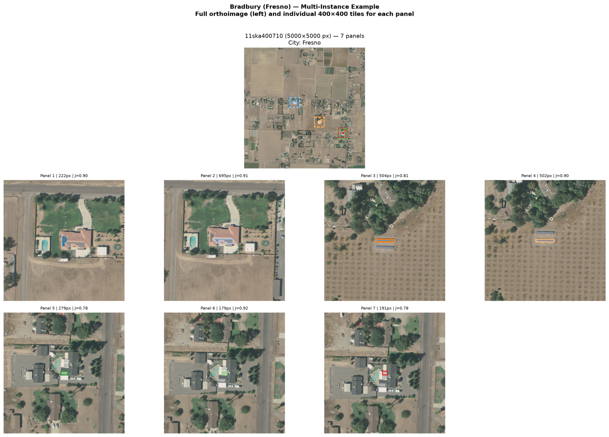
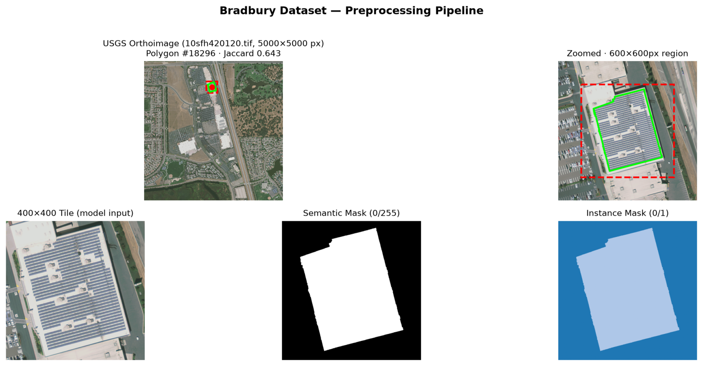
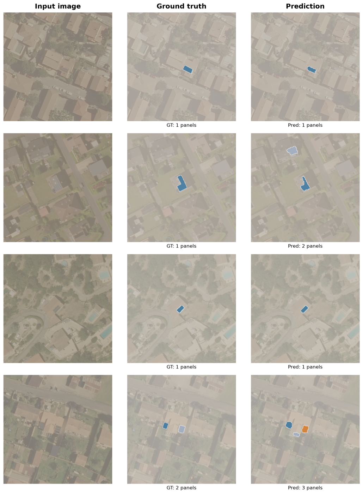

Distributed solar (rooftop and ground-mount) is growing fast, and utilities, planners and researchers need an **accurate, up-to-date inventory** of where panels are. Manually annotating aerial imagery does not scale — millions of tiles. This project builds an end-to-end pipeline that automatically **detects and delineates solar panel** from aerial and satellite imagery, fine-tuning a vision foundation model and evaluating it with panoptic-quality metrics.

<!-- ## The problem

- Distributed solar is growing fast, and a reliable spatial inventory matters for grid-impact studies, adoption trends, incentive policy and siting analysis.
- Manual annotation of aerial imagery does not scale — there are millions of tiles to review.
- **Goal:** automatically detect and delineate every solar panel from aerial / satellite imagery. -->

## The task: panoptic segmentation

Three related tasks, in increasing difficulty:

| Task | Question it answers |
|------|---------------------|
| Semantic segmentation | *Which pixels are solar panels?* |
| Instance segmentation | *Which panel is which?* (separate touching panels) |
| **Panoptic segmentation** | **Both at once** — a class per pixel **and** a unique ID per panel |

We solve **panoptic** segmentation: it yields both a coverage map and a panel count per scene.



*Bradbury (Fresno) — seven annotated panels in one 5000×5000 scene; each is extracted as a separate 400×400 tile.*

## Data

| Dataset | Region | Imagery | Annotations | GSD | License |
|---------|--------|---------|-------------|-----|---------|
| **Bradbury** (2016) | California, US | 601 orthos (5000×5000) | 19.8K polygons | 0.3 m | CC0 |
| **BDAPPV** (2023) | France | 46K tiles (400×400) | 21K masks | 0.1–0.2 m | CC-BY |

- **Bradbury:** vector polygons → tiled into 400×400 crops centred on each panel.
- **BDAPPV:** binary masks → connected-component labelling to recover instances.
- Two very different domains (resolution, geography, annotation style) — good for testing robustness.

## Preprocessing pipeline



*5000×5000 orthoimage → polygon annotation → 400×400 tile → semantic mask (0/255) → instance mask.*

## Model: Mask2Former

- **Universal segmentation** architecture [Mask2Former (CVPR 2022)](https://github.com/facebookresearch/Mask2Former).
- **Masked-attention decoder** predicts a set of mask-class $(M, s)$ pairs.
- Backbone: [**Swin Transformer**](https://huggingface.co/docs/transformers/model_doc/swin), **pretrained** on [COCO](https://cocodataset.org/#home) panoptic dataset; we fine-tune end-to-end, replacing the head for **2 classes** (background, panel).
<!-- - Loss = cross-entropy (class) **+** Dice **+** sigmoid-focal (mask), summed with **auxiliary deep supervision** at every decoder layer. -->
- 3 backbone sizes: **Tiny** (Swin-T), **Base** (-B), and **Large** (-L) — the decoder head is identical.
- **Loss** calculation in 2 stages. For each image, given a set of $P$ predicted mask-class pairs $(M_i, y_i), M_i \in \mathbb{R}^{H\times W}, y\in (0,1)^2$, and $Q$ truth pairs $(\hat{M}_j, \hat{y}_j)$. \
*Stage 1:* Hungarian matching -- Construct a cost matrix $C \in \mathbb{R}^ { N\times K}$ : $$ C_{ij} = w_c (1- y_i(\hat{y}_j)) + w_m \mathrm{BCE}(M_i, \hat{M}_j) + w_d \mathrm{Dice}(M_i, \hat{M}_j)$$
The BCE and Dice costs are computed from a subsample of $K$ points. Let $m_k$ ($\hat{m}_k$) be the value of the mask matrix $M$ (truth mask matrix $\hat{M}$) at point $k$
$${\text{Dice}} = 1 - \frac{2\sum_k p_k\,\hat{m}_k + 1}{\sum_k p_k + \sum_k \hat{m}_k + 1}, \qquad p_k = \sigma(\text{m}_k),\ \hat{m}_k \in \{0,1\}$$
$$\text{BCE} = \frac{1}{K}\sum_k \Big[\,\hat{m}_k \log p_k + (1-\hat{m}_k)\log\big(1-p_k\big)\Big]$$
The weights are set to $w_c = 2.0, w_m=5.0, w_d=5.0$.
From the cost matrix, find the optimal 1-to-1 assignment between the predictions and the truth panels. The loss function is evaluated on these pairs. 
## Training procedure

- **Framework:** PyTorch Lightning + HuggingFace Transformers.
- **Config:** Hydra (composable YAML) · **Tracking:** MLflow.
- **Precision:** bf16-mixed · **Hardware:** A100 (40 GB).
- **Optimizer:** AdamW, $\mathrm{lr}=3\times 10^{-5}$, cosine decay, 500-step warmup, weight decay 0.01.
- **Augmentation:** horizontal flip, colour jitter, Gaussian blur.

## Evaluation metrics

**mIoU** (semantic): mean over classes of the intersection-over-union of pixels.

**Panoptic Quality (PQ)** — the standard metric, with a clean decomposition:

$$\text{PQ} = \text{SQ} \times \text{RQ}$$

- **SQ** — *Segmentation Quality:* mean IoU of matched panels → boundary accuracy.
- **RQ** — *Recognition Quality:* F1-like detection score → did we find the panels?
- A predicted panel counts as a **true positive** only if its `IoU > 0.5`.

PQ is the honest number — mIoU is flattered by the large, easy background class.

## Experiment: backbone scaling

Identical config, only the Swin backbone changes. **Full BDAPPV test set (~3,148 images).**

| Backbone | Params | **PQ** | SQ | RQ | mIoU | test loss |
|----------|--------|--------|-----|-----|------|-----------|
| Swin-T | 47 M | 0.712 | 0.772 | 0.891 | 0.861 | 8.22 |
| Swin-B | 110 M | 0.694 | 0.771 | 0.869 | 0.850 | 8.02 |
| Swin-L | 216 M | **0.714** | 0.774 | 0.891 | 0.861 | **7.89** |

- **Swin-T ≈ Swin-L** (statistical tie) — both clearly above **Swin-B**.
- A 47 M-parameter model matches one **4.6× larger**.

## Key finding: loss ≠ segmentation quality

```
test loss:   T 8.22  →  B 8.02  →  L 7.89     (monotonic ↓ with size)
PQ:          T 0.712 →  B 0.694 →  L 0.714    (non-monotonic)
```

- Loss improves monotonically with model size — **panoptic quality does not**.
- **SQ is flat** (0.771–0.774) across all sizes → panel *shape* segmentation is saturated.
- All differences live in **RQ** (detection) → the real lever is *finding* panels, not outlining them.
- **Lesson:** for segmentation, don't select models on loss alone — measure PQ directly.

## Predictions from the trained model



*Input · ground truth · model prediction (each panel a distinct colour).*

## Takeaways & next steps

**Delivered**

- End-to-end pipeline: multi-dataset data → Mask2Former fine-tuning → PQ/SQ/RQ evaluation.
- Fully config-driven (Hydra), tracked (MLflow), reproducible.
- A small Swin-T matches a much larger Swin-L on panoptic quality.

**Next steps**

- Optimise **RQ directly** — confidence-threshold tuning, more instance-rich data (Bradbury).
- **Cross-domain transfer:** train on France (BDAPPV), evaluate on California (Bradbury).
- **Live acquisition:** on-demand imagery via Google Earth Engine / Sentinel Hub APIs.
